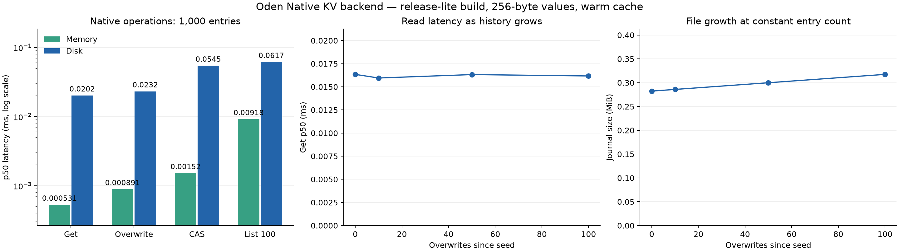

# Oden Native KV ベンチマーク

変更キーだけを保存する差分ログ、状態キャッシュ、変更分のundo、TTL索引、メモリ操作のworker往復削減を適用した後の測定。
表・グラフ・生データはNativeのみ。SQLiteとの同条件比較は速度比で示す（SQLite p50
÷ Native p50、1より大きければNativeが速い）。



## 条件

- Linux x86_64、AMD EPYC 9V74、3
  vCPU、共有クラウド環境。/tmpのoverlay、温めたOSキャッシュ。
- Rust
  Databaseトレイトを直接呼ぶ`release-lite`ビルド。JavaScript/V8とキーエンコードはこの測定に含まない。
- `release-lite`はリポジトリ既定の最適化プロファイル（Native/SQLite
  Rustコードはopt-level=z、thin LTO）。
- 値256バイト、キーは4バイトのbig-endian整数。100件・1,000件・10,000件、単一クライアントの逐次操作。
- 各条件1,000操作×5回、各回新規DB。DB準備と5回の読み取りは除外。比較の実行順序は各回交互。
- p50/p95は5,000サンプルのnearest-rank、ops/sは5回の中央値。
- Nativeは毎コミットOSロック＋sync_all。SQLiteは既存のDeno互換実装、既定WAL設定。耐久性設定は変更していない。
- CASは読み取り＋versionstampチェック付き更新、list_100は100件の値取得。
- ビルド・テスト・他のベンチを同時実行していない。共有ホストの負荷は制御できず、全環境・全ワークロードでの優位を保証する測定ではない。

## バックエンドのレイテンシー

|   件数 | 保存   | 操作      | Native p50 (ms) | Native p95 (ms) | Native ops/s | SQLiteに対するp50速度比 |
| -----: | ------ | --------- | --------------: | --------------: | -----------: | ----------------------: |
|    100 | disk   | cas       |          0.0382 |          0.0620 |       23,253 |                   1.71× |
|    100 | disk   | get       |          0.0154 |          0.0220 |       58,458 |                   1.75× |
|    100 | disk   | list_100  |          0.0327 |          0.0487 |       28,101 |                   1.98× |
|    100 | disk   | overwrite |          0.0226 |          0.0338 |       40,544 |                   1.23× |
|    100 | memory | cas       |          0.0011 |          0.0014 |      808,110 |                  47.16× |
|    100 | memory | get       |          0.0004 |          0.0005 |    1,944,107 |                  79.59× |
|    100 | memory | list_100  |          0.0089 |          0.0091 |      108,596 |                   7.11× |
|    100 | memory | overwrite |          0.0006 |          0.0008 |    1,425,667 |                  36.24× |
|  1,000 | disk   | cas       |          0.0545 |          0.0780 |       17,052 |                   1.54× |
|  1,000 | disk   | get       |          0.0202 |          0.0287 |       43,076 |                   1.76× |
|  1,000 | disk   | list_100  |          0.0617 |          0.0876 |       17,610 |                   1.36× |
|  1,000 | disk   | overwrite |          0.0232 |          0.0387 |       38,983 |                   1.28× |
|  1,000 | memory | cas       |          0.0015 |          0.0017 |      623,473 |                  35.75× |
|  1,000 | memory | get       |          0.0005 |          0.0007 |    1,612,368 |                  48.64× |
|  1,000 | memory | list_100  |          0.0092 |          0.0117 |       84,523 |                   7.09× |
|  1,000 | memory | overwrite |          0.0009 |          0.0011 |    1,024,473 |                  35.37× |
| 10,000 | disk   | cas       |          0.0451 |          0.0666 |       20,745 |                   1.47× |
| 10,000 | disk   | get       |          0.0189 |          0.0267 |       46,921 |                   1.60× |
| 10,000 | disk   | list_100  |          0.0412 |          0.0935 |       22,742 |                   1.75× |
| 10,000 | disk   | overwrite |          0.0270 |          0.0381 |       35,092 |                   1.11× |
| 10,000 | memory | cas       |          0.0019 |          0.0025 |      428,615 |                  31.01× |
| 10,000 | memory | get       |          0.0007 |          0.0012 |    1,099,687 |                  36.04× |
| 10,000 | memory | list_100  |          0.0117 |          0.0122 |       79,854 |                   5.67× |
| 10,000 | memory | overwrite |          0.0012 |          0.0018 |      721,846 |                  19.46× |

中央値でNativeが速かった条件は24/24。速度比は1.11〜79.59倍。p95と回ごとの速度比は集計JSONに収録。

## JavaScript APIも含む確認

`Oden.openKv()`と`Deno.openKv()`を同じdebug CLIで呼ぶ別測定。キーは["bench",
number]、値はUint8Array(256)、1,000件。
各条件1,000操作×5回、100回の同じ操作でウォームアップ。型付き配列のV8シリアライズ、キーエンコード、JS
Promise、一覧の非同期反復を含む。
release-liteのRustトレイト測定と数値を直接比較できない。

| 保存   | 操作      | Native p50 (ms) | Native p95 (ms) | SQLiteに対するp50速度比 |
| ------ | --------- | --------------: | --------------: | ----------------------: |
| disk   | cas       |          0.3722 |          0.4932 |                   1.11× |
| disk   | get       |          0.1476 |          0.2207 |                   1.34× |
| disk   | list_100  |          0.7565 |          0.9644 |                   1.23× |
| disk   | overwrite |          0.1477 |          0.2690 |                   1.16× |
| memory | cas       |          0.0860 |          0.1482 |                   4.31× |
| memory | get       |          0.0256 |          0.0593 |                   7.05× |
| memory | list_100  |          0.6036 |          0.9029 |                   1.54× |
| memory | overwrite |          0.0155 |          0.0224 |                   9.48× |

## 更新履歴の影響

同じ1,000件のDBに追加で100回上書き。各点のgetは10回、成長試験は1回。reopenは再オープン＋最初のget＋close。

| 上書き回数 | ファイル (MiB) | get p50 (ms) | get p95 (ms) | reopen (ms) |
| ---------: | -------------: | -----------: | -----------: | ----------: |
|          0 |          0.282 |       0.0163 |       0.0333 |       5.263 |
|         10 |          0.286 |       0.0160 |       0.0182 |      16.471 |
|         50 |          0.300 |       0.0163 |       0.0195 |       5.962 |
|        100 |          0.317 |       0.0162 |       0.0214 |      10.678 |

## 改善前と制約

改善前のNative測定は[before/summary.json](before/summary.json)と[before/results-debug.jsonl](before/results-debug.jsonl)に保存。
改善前はdebugビルド・30操作×3回なので、今回の最適化ビルドと直接の倍率比較はできない。
改善前は全状態を各更新で保存し全履歴を毎操作で復元した。今回の通常読み取りは履歴を復元せず、更新は変更キーだけを追記する。
ログ圧縮は未実装。起動時には全履歴を1回復元し、ログは更新量に応じて増える。生存データの索引はメモリに保持する。
今回の比較は逐次CRUDが対象で、大きな値、多数の同時クライアント、長期履歴、キュー・watchの速度は未評価。

## 再実行

```sh
cargo build -p deno_kv --profile release-lite --example kv_bench --features sqlite,deno_core/v8
target/release-lite/examples/kv_bench --compare-sqlite > /tmp/kv-compare.jsonl
target/debug/oden run --unstable-kv -A tests/bench/kv-native/api_bench.ts --compare-sqlite > /tmp/kv-api-compare.jsonl
python tests/bench/kv-native/summarize.py --profile release-lite --input /tmp/kv-compare.jsonl --api-input /tmp/kv-api-compare.jsonl
python tests/bench/kv-native/plot.py
```

比較用のSQLite生データは/tmpの一時ファイルにだけ出力。公開用の生データ・集計ではSQLiteの絶対値を除き、比較の速度比を残す。
`kv_bench`・`api_bench.ts`は引数なしならNativeだけを実行する。グラフ生成にはmatplotlibが必要。

- [Rust計測コード](../../../ext/kv/examples/kv_bench.rs)
- [JS API計測コード](api_bench.ts)
- [Native生データ](results-release-lite.jsonl)
- [JS API Native生データ](results-api-debug.jsonl)
- [集計と速度比](summary.json)
- [測定環境・ソース識別情報](environment.json)
